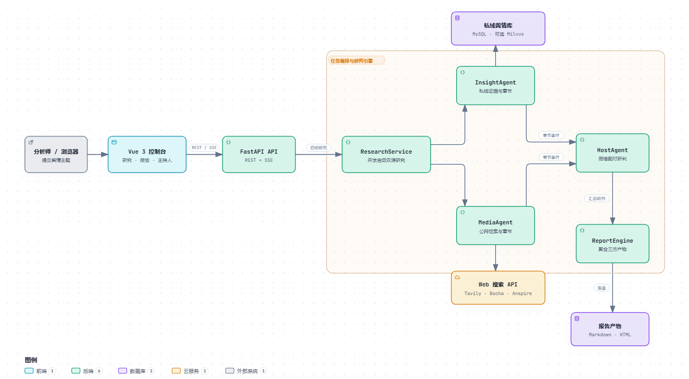
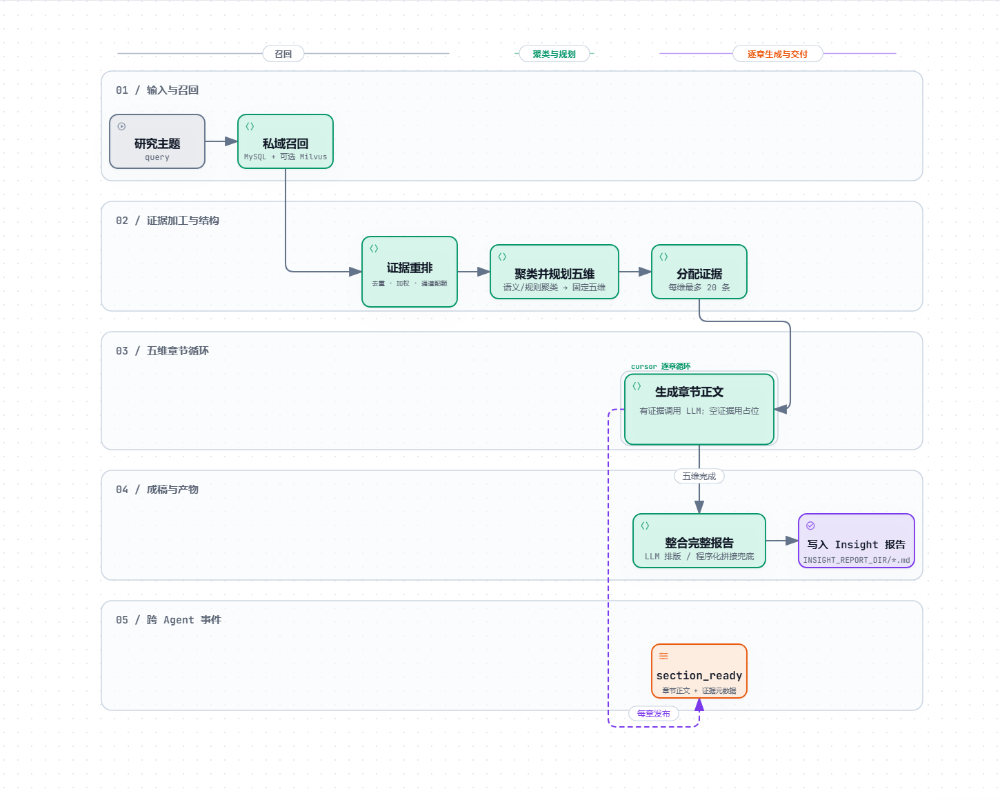
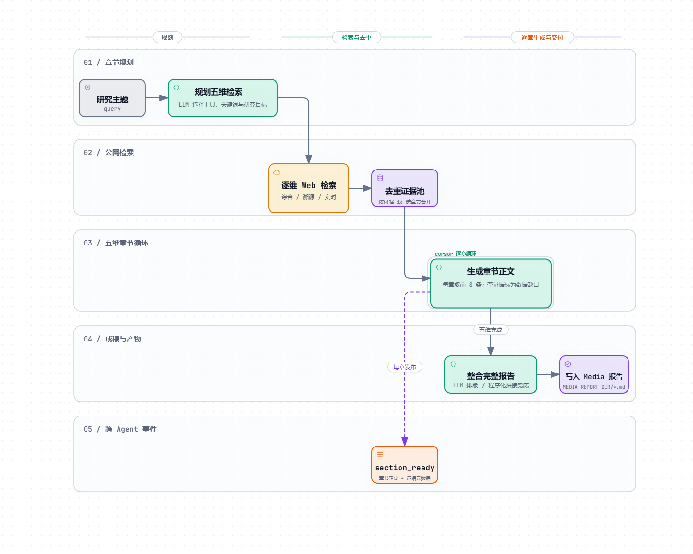
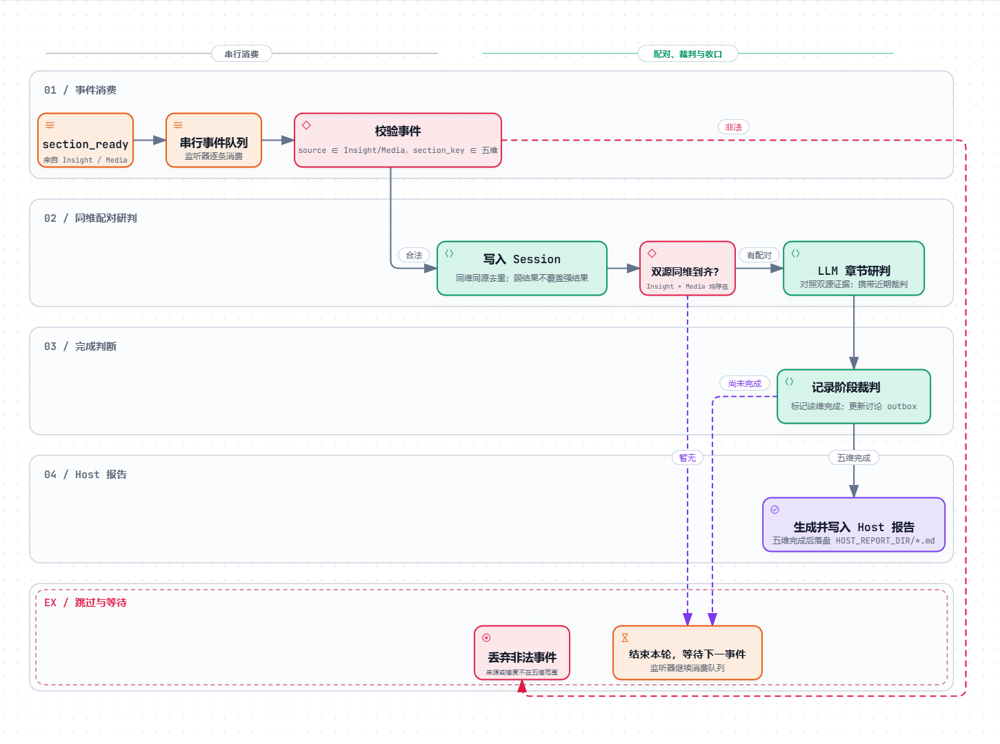
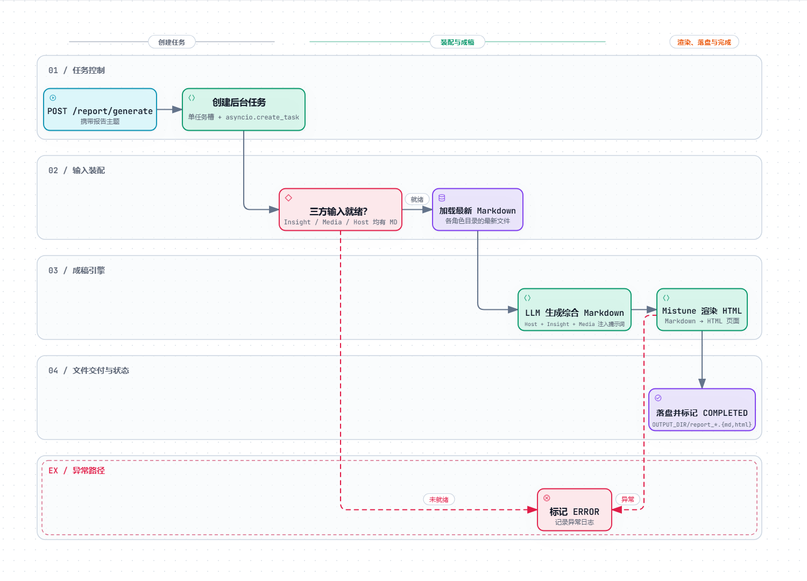

# OpinionArbiter | 双源多智能体舆情研判平台

<div align="center">

从私域舆情库与公开网络并行取证，围绕统一五维框架完成多 Agent 章节分析；HostAgent 对同一维度下的双源结论进行配对研判，最后由 ReportEngine 汇总为 Markdown / HTML 综合报告。


</div>

> 示例主题：**“某品牌新品发布后的舆论态势”**<br>
> InsightAgent 从私域内容与评论中提取线索，MediaAgent 从公开网络补充背景和传播信息；HostAgent 按同一研究维度对照双方结论，再生成综合研判报告。

## 核心能力

| 能力 | 实现方式 | 解决的问题 |
|---|---|---|
| **双源并行研究** | `ResearchService` 通过 `asyncio.create_task` 同时启动 InsightAgent 与 MediaAgent | 私域数据与公开网络各自取证，避免单一来源覆盖不足 |
| **固定五维框架** | `engines/contracts/dimensions.py` 统一约束背景、热度、情感、群体差异、深层影响五个章节 | 两个来源按相同结构产出，便于逐维对照 |
| **私域多通道召回** | MySQL 内容、评论、热度三通道 + `jieba` 关键词扩展；可选 BGE-M3 生成稠密/稀疏向量，经 Milvus RRF 混合检索 | 同时覆盖精确关键词、评论观点、高热内容和语义近邻 |
| **公网专题检索** | MediaAgent 为每个维度选择综合、溯源或实时检索，统一接入 Tavily、Bocha、Anspire | 为事件背景、传播脉络和最新进展补充外部证据 |
| **事件驱动研判** | Insight 与 Media 的章节完成后发布 `section_ready`；HostAgent 按 `section_key` 配对，两源到齐后调用 LLM 研判 | 不必等待完整报告落盘，即可按维度持续推进综合判断 |
| **报告生成与交付** | 汇集 Host、Insight、Media 的 Markdown，调用报告模型成稿，再用 Mistune 渲染 HTML | 同时提供可编辑的 Markdown 与可直接预览/下载的 HTML |
| **实时控制台** | Vue 3 提供研究、报告、主持人、配置四个页签；SSE 推送角色进度，REST 获取结果和文件 | 长任务执行过程可见，结果获取与报告生成集中在一个界面 |

## 系统架构

[](.archify/architecture-opinion-arbiter-20261018-223415/opinion-arbiter-architecture.html)

主链路为：`Vue 3 控制台 → FastAPI → ResearchService → InsightAgent / MediaAgent → HostAgent → ReportEngine → Markdown / HTML`。

实线表示主要调用或数据流；图中的“章节事件”对应代码里由进程内事件总线传递的 `section_ready`。为保持总览简洁，图中没有单独展开各角色的大模型调用和事件总线内部实现。点击架构图可打开交互式 HTML。

## 双源研判工作流

| 阶段 | 执行入口 | 产出 |
|---|---|---|
| **1. 启动研究** | `POST /api/research` → `ResearchService.start_research()` | 返回“已启动”，后台并发运行两个研究角色 |
| **2. 双源取证** | InsightAgent 检索 MySQL/可选 Milvus；MediaAgent 调用 Web 搜索 | 两个角色各自完成五维章节与完整 Markdown 报告 |
| **3. 同维研判** | 章节完成即发布 `section_ready`；HostAgent 按维度累积并配对 | 每对到齐后生成主持人阶段裁判；五维完成后生成 Host 最终报告 |
| **4. 综合成稿** | `POST /api/report/generate` → `ReportService` → `ReportEngine` | 读取三方最新 Markdown，生成综合 Markdown 并渲染 HTML |
| **5. 展示与下载** | SSE `/api/events/stream`、研究结果与报告下载接口 | 前端实时展示进度，并下载 `.md` / `.html` 报告 |

HostAgent 必须处于监听状态，才会消费章节事件。Web 控制台在研究页会依次执行 `stopHost → startHost → startResearch`；直接调用后端 API 时，需要先请求 `GET /api/host/start`。

## Agent 内部运行逻辑

下面四张图展开代码中的主要控制流。InsightAgent 和 MediaAgent 都按固定五维逐章执行，章节完成后立即发布 `section_ready`；“cursor 逐章循环”表示当前章节处理完后由路由函数继续读取下一章，直到五维全部结束。点击任一图片可打开对应的交互式 HTML。

### 1. InsightAgent

先并行执行 MySQL 内容、评论、热度三通道召回与可选 Milvus 语义召回，再对证据去重、加权并限制为最多 50 条。证据按语义或关键词规则聚类后，LLM 规划结果会强制对齐固定五维，每维最多分配 20 条证据。章节正文有证据时调用 LLM，空证据时写入固定占位；五维完成后才进入整篇排版和 Markdown 落盘。

[](.archify/workflow-agent-internals-20261018-224529/insight-agent.html)

### 2. MediaAgent

LLM 先为五个研究维度规划检索关键词、分析目标和检索工具，可选用综合、溯源或实时检索。SearchNode 逐维调用当前搜索 Provider，并按证据 ID 合并去重；SectionSummarizeNode 为每个章节从去重池取前 8 条证据，空证据直接标记为“数据缺口”。五维章节完成后统一生成完整报告。

[](.archify/workflow-agent-internals-20261018-224529/media-agent.html)

### 3. HostAgent

SectionReadyListener 订阅事件并通过异步队列串行驱动研判图。每个事件先校验来源是否为 `insight/media`、章节是否属于固定五维；合法结果写入 Session，同维同源结果按证据强度、命中数和正文长度去重。只有 Insight 与 Media 的同一 `section_key` 都到齐才调用 LLM 研判，五维全部记录完成后生成并保存 Host 最终报告。未凑齐或未完成的轮次结束本轮，继续等待下一事件。

[](.archify/workflow-agent-internals-20261018-224529/host-agent.html)

### 4. ReportEngine

ReportEngine 不是 LangGraph Agent，而是最终报告角色。ReportService 先创建后台任务，再确认 Insight、Media、Host 三份 Markdown 均已存在，随后读取三个角色目录中的最新文件。报告模型生成综合 Markdown，Mistune 渲染 HTML，二者写入 `OUTPUT_DIR` 后任务标记为 `COMPLETED`；生成过程中的异常会记录日志并将任务标记为 `ERROR`。

[](.archify/workflow-agent-internals-20261018-224529/report-engine.html)

## 技术栈

| 层级 | 选型 | 职责 |
|---|---|---|
| 前端 | Vue 3 + Vite | 研究进度、报告预览、主持人讨论与运行配置 |
| 服务 | FastAPI + Uvicorn + Pydantic | REST API、请求校验、依赖注入与 SSE 事件流 |
| 工作流 | LangGraph `StateGraph` | 三个 Agent 的节点编排、条件路由与章节循环 |
| 大模型 | LangChain `init_chat_model` + OpenAI 兼容接口 | Insight、Media、Host、Report 按角色独立配置模型和 Base URL |
| 私域检索 | SQLAlchemy + `aiomysql` + `jieba` | 跨平台内容、评论与热度召回 |
| 语义检索 | Milvus + BGE-M3 + `pymilvus` | 可选稠密/稀疏双路召回，并用 RRF 融合 |
| 公网检索 | Tavily / Bocha / Anspire | 综合检索、来源溯源和实时进展查询 |
| 报告 | Mistune + 本地文件系统 | Markdown 成稿、HTML 渲染及角色产物落盘 |
| 实时通信 | SSE + 进程内事件总线 | 推进角色进度、完成与错误事件；广播讨论消息 |

## 快速开始

### 1. 环境要求

- Python `3.11+`，依赖管理使用 [`uv`](https://docs.astral.sh/uv/)
- Node.js 与 npm，用于启动 Vue 前端
- 可访问的私域 MySQL 舆情库
- 四个角色的 LLM API，以及至少一个 Web 搜索服务凭据
- 启用 Milvus、BGE-M3 或语义聚类时，需要对应的 Milvus 服务、模型文件与可选 `ml` 依赖

### 2. 安装后端依赖

```powershell
uv sync
```

`INSIGHT_VECTOR_ENABLED` 或 `INSIGHT_CLUSTERING_ENABLED` 启用时，再安装可选机器学习依赖：

```powershell
uv sync --extra ml
```

### 3. 配置环境变量

```powershell
Copy-Item .env.example .env
```

按本机环境修改 `.env`。示例中的模型路径与 Milvus 地址仅作占位，需要替换为实际值。

| 配置组 | 关键变量 | 说明 |
|---|---|---|
| 服务 | `HOST`、`PORT` | 默认监听 `0.0.0.0:5000` |
| 数据库 | `DB_HOST`、`DB_PORT`、`DB_USER`、`DB_PASSWORD`、`DB_NAME` | InsightAgent 的私域 MySQL 连接 |
| Insight 模型 | `INSIGHT_ENGINE_API_KEY`、`INSIGHT_ENGINE_BASE_URL`、`INSIGHT_ENGINE_MODEL_NAME`、`INSIGHT_ENGINE_MODEL_PROVIDER` | 中文私域证据归纳与章节写作 |
| Media 模型 | `MEDIA_ENGINE_API_KEY`、`MEDIA_ENGINE_BASE_URL`、`MEDIA_ENGINE_MODEL_NAME`、`MEDIA_ENGINE_MODEL_PROVIDER` | 公网资料整理与章节写作 |
| Host 模型 | `HOST_API_KEY`、`HOST_BASE_URL`、`HOST_MODEL_NAME`、`HOST_MODEL_PROVIDER` | 同维对照、阶段裁判与最终研判 |
| Report 模型 | `REPORT_ENGINE_API_KEY`、`REPORT_ENGINE_BASE_URL`、`REPORT_ENGINE_MODEL_NAME`、`REPORT_ENGINE_MODEL_PROVIDER` | 综合报告成稿 |
| 搜索 | `SEARCH_SWITCH`、`TAVILY_API_KEY`、`BOCHA_API_KEY`、`ANSPIRE_API_KEY` | `SEARCH_SWITCH` 可取 `TavilyAPI`、`BochaAPI`、`AnspireAPI` |
| 向量检索 | `INSIGHT_VECTOR_ENABLED`、`MILVUS_URI`、`MILVUS_INSIGHT_COLLECTION`、`INSIGHT_EMBEDDING_MODEL`、`INSIGHT_DENSE_DIM`、`INSIGHT_VECTOR_TOP_K` | 控制 Milvus 与 BGE-M3 混合召回 |
| 语义聚类 | `INSIGHT_CLUSTERING_ENABLED`、`INSIGHT_CLUSTER_MODEL`、`INSIGHT_CLUSTER_MAX_RECORDS`、`INSIGHT_CLUSTER_MAX_CLUSTERS`、`INSIGHT_CLUSTER_MIN_CLUSTER_SIZE` | 控制证据聚类；未配置模型时回退到关键词规则 |
| 报告目录 | `OUTPUT_DIR`、`INSIGHT_REPORT_DIR`、`MEDIA_REPORT_DIR`、`HOST_REPORT_DIR` | 各角色产物与最终报告的输出位置 |

向量检索与语义聚类都依赖可选 `ml` 包。没有 Milvus 或本地模型时，可关闭对应开关，让 InsightAgent 仅使用 MySQL 三通道召回和规则聚类。

### 4. 启动后端

```powershell
uv run python main.py
```

默认地址：

- API 服务：<http://127.0.0.1:5000>
- 接口文档：<http://127.0.0.1:5000/docs>

### 5. 启动前端

```powershell
cd front
npm ci
npm run dev
```

访问 <http://127.0.0.1:3000>。Vite 会把 `/api` 请求代理到 `http://localhost:5000`。

### 6. 发起一次分析

最简单的方式是在“研究”页输入舆情主题并启动。前端会自动启动 HostAgent、创建研究任务，并通过 SSE 显示两个研究角色的进度。

直接使用接口时，可按以下顺序执行：

```powershell
# 1. 先启动 HostAgent，确保章节事件有人消费
curl.exe http://127.0.0.1:5000/api/host/start

# 2. 启动双源研究
curl.exe -X POST http://127.0.0.1:5000/api/research `
  -H "Content-Type: application/json" `
  --data-raw '{"query":"某品牌新品发布后的舆论态势"}'

# 3. 另开终端订阅实时进度
curl.exe -N http://127.0.0.1:5000/api/events/stream

# 4. 查看 Insight、Media、Host 报告是否已准备
curl.exe http://127.0.0.1:5000/api/report/status

# 5. 触发生成综合报告
curl.exe -X POST http://127.0.0.1:5000/api/report/generate `
  -H "Content-Type: application/json" `
  --data-raw '{"query":"某品牌新品发布后的舆论态势"}'
```

`POST /api/report/generate` 会立即返回 `task_id`。随后轮询 `GET /api/report/result/{task_id}`，任务完成并有报告内容后才返回 HTML。

## 接口概览

| 模块 | 方法 | 路径 | 说明 |
|---|---|---|---|
| 配置 | `GET` | `/api/config` | 获取前端可编辑的运行配置 |
| 配置 | `POST` | `/api/config` | 更新配置并写入 `.env`，部分变更需重启 |
| 主持人 | `GET` | `/api/host/start` | 启动 HostAgent 事件监听 |
| 主持人 | `GET` | `/api/host/stop` | 停止监听并清空当前研判会话 |
| 主持人 | `GET` | `/api/host/discussion` | 获取内存中的讨论记录 |
| 研究 | `POST` | `/api/research` | 提交 `query`，后台并发启动 Insight 与 Media |
| 研究 | `GET` | `/api/research/latest` | 获取两个研究角色各自最新的 Markdown 报告 |
| 实时事件 | `GET` | `/api/events/stream` | SSE 推送 `role_progress`、`role_result`、`role_error` |
| 报告 | `GET` | `/api/report/status` | 检查三个角色目录是否均有 Markdown 文件 |
| 报告 | `POST` | `/api/report/generate` | 创建后台报告生成任务并返回 `task_id` |
| 报告 | `GET` | `/api/report/result/{task_id}` | 任务完成后返回 HTML 内容 |
| 报告 | `GET` | `/api/report/download/{task_id}/{file_type}` | 下载 `html` 或 `md` 文件 |

## 项目结构

```text
.
├── app/
│   ├── routers/
│   │   ├── rest/             # 研究、报告、Host、配置 API
│   │   └── sse/              # SSE 事件流入口
│   ├── schemas/              # 请求与响应模型
│   ├── services/
│   │   ├── research/         # 研究任务服务
│   │   ├── report/           # 报告任务、输入加载与文件下载
│   │   ├── host/             # Host 启停与讨论缓冲
│   │   ├── realtime/         # SSE 广播
│   │   ├── lifecycle/        # 应用启停协调
│   │   └── system/           # 运行配置读写
│   ├── app.py                # FastAPI 应用与路由注册
│   └── dependencies.py       # 全局服务与依赖注入
├── engines/
│   ├── insight_agent/        # 私域召回、聚类、五维章节与 LangGraph 流程
│   ├── media_agent/          # 公网检索、章节生成与搜索 Provider 适配
│   ├── host_agent/           # 章节配对、阶段研判与最终裁判
│   ├── report_engine/        # 综合 Markdown 生成与 HTML 渲染
│   ├── orchestration/        # 双研究角色并发编排
│   ├── contracts/            # 五维、角色、事件、证据与配置契约
│   └── common/               # 事件总线、LLM 客户端、通用节点与文件 IO
├── front/
│   └── src/                  # Vue 3 控制台与 API/SSE 客户端
├── .archify/                 # 架构图源文件、交互式 HTML 与静态预览
├── main.py                   # Uvicorn 启动入口
├── pyproject.toml
├── uv.lock
└── .env.example
```

`data/report/` 用于运行时报告产物，默认被 `.gitignore` 排除。实际目录由 `OUTPUT_DIR`、`INSIGHT_REPORT_DIR`、`MEDIA_REPORT_DIR`、`HOST_REPORT_DIR` 决定。

## 运行边界

- **私域源范围**：当前 `PLATFORM_MAPPING` 只映射抖音和微博的内容/评论表；数据库连接固定使用 `mysql+aiomysql`，`DB_DIALECT` 尚未参与驱动切换。
- **Host 启动顺序**：章节事件是实时事件，没有离线回放。直接调用研究接口前必须先启动 HostAgent，否则已发布的 `section_ready` 不会被补消费。
- **进程内状态**：研究后台任务、事件总线、讨论缓冲和报告任务存储器都在应用进程内；应按单 worker 运行，重启后未完成任务与讨论记录会丢失。
- **报告输入选择**：`ReportInputLoader` 分别读取三个角色目录中“最新修改”的 Markdown，不按当前 `query` 绑定文件。并发研究或多轮任务混用时，应为不同任务隔离输出目录或先清理旧产物。
- **搜索开关**：后端实际读取 `SEARCH_SWITCH`，当前配置页写入的是 `SEARCH_TOOL_TYPE`。切换搜索供应商时，应直接修改 `.env` 中的 `SEARCH_SWITCH` 并重启服务。
- **服务安全**：当前 CORS 为 `allow_origins=["*"]`，API 未内置认证、限流与来源白名单，生产部署应在网关层补齐。
- **质量门禁**：仓库当前没有自动化测试或 CI 配置；本 README 的结构与接口描述以当前源码和运行时 OpenAPI 为准。
